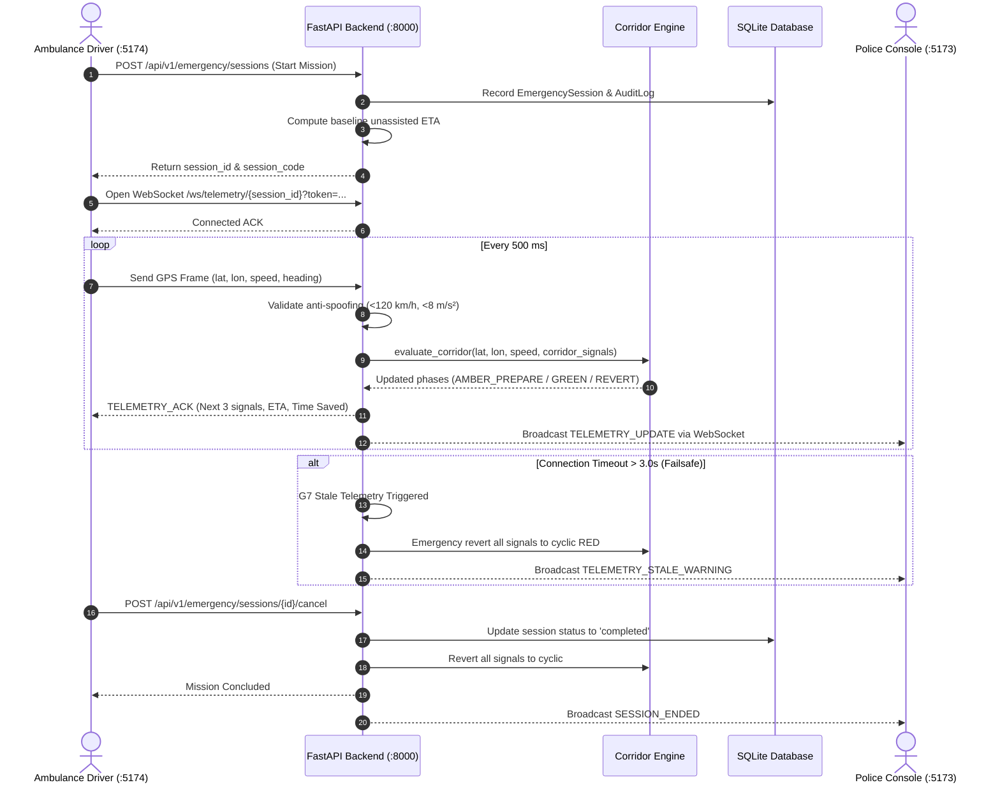

# LifeLane AI — System Architecture & Developer Guide

> *"It doesn't just build a faster route. It builds a safer city."*

---

## 1. Executive Summary & Research Foundation

**LifeLane AI** is a proactive, closed-loop intelligent transportation engineering platform designed to create dynamically moving green corridors for emergency response vehicles (ambulances, fire engines, police) while strictly minimizing collateral congestion for civilian commuters.

### Core Problem
In dense urban arterial networks, emergency vehicles encounter severe congestion, delayed signal cycles, and acoustic occlusion. A transit delay of **60 to 90 seconds can be fatal** in acute trauma or cardiac arrest. However, static overrides or manual police clearance frequently result in massive cross-street gridlock that takes hours to dissipate.

### Research Breakthroughs
1. **Traffic Flow Forecasting (Deep Learning):**
   * *Citation:* Xiao, H., Zou, B., & Xiao, J. (2025). Graph convolution networks based on adaptive spatiotemporal attention for traffic flow forecasting. *Scientific Reports*, 15, 8935.
   * *Concept:* GAA-GCN + LSTM architecture forecasting link-level congestion 5–10 minutes downstream.
2. **Vehicle Perception (Edge Vision):**
   * *Citation:* Noor, A., et al. (2024). A cloud-based ambulance detection system using YOLOv8 for minimizing ambulance response time. *Applied Sciences (MDPI)*, 14(6), 2555.
   * *Concept:* High-speed edge object detection adapted to YOLOv11 for intersection preemption confirmation.
3. **Constrained Dynamic Routing & Civilian Evacuation:**
   * *Citation:* Duan, X. H., Wu, J. X., & Xiong, Y. L. (2022). Dynamic emergency vehicle path planning and traffic evacuation based on salp swarm algorithm. *Journal of Advanced Transportation*, 2022, Article 7862746.
   * *Concept:* Multi-factor path planning constrained by civilian Traffic Congestion Index ($< 90\text{ s}$ commuter delay cap).

---

## 2. Complete System Architecture (The Three Applications)

```
                            ┌────────────────────────────────────────┐
                            │    Emergency Driver Mobile Web App     │
                            │        (Port 5174 · React + Vite)      │
                            └──────────────────┬─────────────────────┘
                                               │
                                               │ 500 ms Telemetry (WS)
                                               ▼
┌──────────────────────────┐ WebSocket  ┌────────────────────────────────────┐
│  Police Command Portal   │◄───────────┤          FastAPI Backend           │
│ (Port 5173 · React+Vite) │ Broadcast  │            (Port 8000)             │
└──────────────────────────┘            └──────────────┬─────────────────────┘
                                                       │
                                                       │ Async SQLite / PostGIS
                                                       ▼
                                        ┌────────────────────────────────────┐
                                        │ Database (lifelane.db / Postgres)  │
                                        └────────────────────────────────────┘
```

---

## 3. Backend Engine (`backend/app/`) — FastAPI Deep Dive

The backend runs on **FastAPI** with **SQLAlchemy 2.0 (async)** and **Pydantic v2**. For lightweight local development, it operates on a verified local SQLite database (`lifelane.db`), with immediate configuration parity for PostgreSQL 16 + PostGIS in production/Docker.

### Directory Structure
```
backend/
├── app/
│   ├── main.py                     # Entry point, ASGI lifecycle, background monitor
│   ├── core/
│   │   ├── config.py               # Application settings, timing windows, JWT parameters
│   │   └── security.py             # PBKDF2 SHA-256 password hashing & JWT token encoder
│   ├── db/
│   │   └── session.py              # Async SQLAlchemy engine & automated table creator
│   ├── models/
│   │   └── all_models.py           # Database entities (User, Vehicle, Session, Telemetry, etc.)
│   ├── schemas/
│   │   └── all_schemas.py          # Pydantic validation schemas
│   ├── services/
│   │   ├── corridor.py             # Two-stage predictive green-corridor state machine
│   │   ├── telemetry_manager.py    # High-frequency telemetry ingest, anti-spoofing, WebSockets
│   │   └── osm_service.py          # Spatial indexing, Haversine baseline ETA, corridor nodes
│   └── api/v1/
│       ├── auth.py                 # JWT login, driver approval, demo seeds
│       ├── emergency.py            # Mission lifecycle: POST /sessions, cancel session
│       ├── telemetry.py            # Bidirectional 500ms WebSocket & REST fallback
│       ├── intersections.py        # Smart intersections registry & manual police override
│       └── ws_police.py            # Police command center broadcast hub
└── tests/                          # Automated integration test suite
```

### Key Subsystems & How They Work

#### 1. Lifecycle & Stale Telemetry Background Daemon (`main.py`)
* Starts up with the async `lifespan` handler, ensuring all tables in `all_models.py` are initialized.
* Launches a persistent background task: `background_stale_telemetry_monitor()`.
* **The G7 Fail-Safe:** If an emergency vehicle's GPS feed drops or disconnects for $> 3.0\text{ seconds}$, the daemon flags the session as stale and automatically reverts all corridor signals back to cyclic red. This guarantees that an app crash will never leave green lights locked indefinitely.

#### 2. Database Entities (`models/all_models.py`)
* `User`: Stores municipal operators, system admins, and emergency drivers. Includes `role` and `is_approved` flags for anti-spoofing security.
* `Vehicle`: Tracks emergency fleet plates (`KA-01-EA-1088`), agency affiliations, and status (`idle`, `emergency`).
* `EmergencySession`: Encapsulates a live mission with origin GPS, hospital destination GPS, baseline unassisted ETA, actual elapsed duration, and dynamic time saved.
* `TelemetryLog`: Time-series GPS frames (`latitude`, `longitude`, `speed_kmh`, `heading_deg`, `is_anomaly`).
* `Intersection`: Traffic signal records (`intersection_code`, `name`, `latitude`, `longitude`, `phase`, `is_corridor_active`).
* `AuditLog`: Immutable audit trail recording user overrides, mission starts, and state transitions.

#### 3. Two-Stage Corridor Preemption State Machine (`services/corridor.py`)
Rather than blindly turning all traffic lights green, the engine calculates the dynamic vehicle arrival time $t_{\text{arrival}} = \text{distance} / \text{speed}$ for upcoming intersections:
* **Lookahead Scope:** Constrained to the **2–3 upcoming intersections** directly along the travel route.
* **Stage 1 — Preparation Window ($< 800\text{ m}$ or $\le 35\text{ s}$ ETA):**
  Signal transitions to `AMBER_PREPARE` (`PRE_CLEARING_ARMED`). Flushes remaining cross-street queues without halting the entire grid.
* **Stage 2 — Actuation Moment ($5\text{–}8\text{ s}$ before arrival):**
  Signal transitions to `GREEN` (`ACTUATED_GREEN_WAVE`). The emergency vehicle clears the junction without deceleration.
* **Post-Passage Reversion ($< 15\text{ m}$ / within $10\text{ s}$ of clearance):**
  Signal enters `REVERTING` (`POST_PASSAGE_REVERT`) and resumes standard cyclic timing to restore commuter flow.

#### 4. High-Frequency Telemetry Orchestrator (`services/telemetry_manager.py`)
* **Concurrency:** Uses `asyncio.Lock` to coordinate real-time updates across multiple vehicles and connections.
* **Anti-Spoofing & Anomaly Detection:**
  * Flags frames if speed exceeds urban emergency limits ($> 120\text{ km/h}$) or acceleration exceeds plausible thresholds ($> 8.0\text{ m/s}^2$).
  * Enforces rate limiting ($\le 10\text{ frames/second}$) to defend against malicious denial-of-service floods.
* **Honest Dynamic Time Saved:** Computes $(t_{\text{baseline}} - t_{\text{projected}})$ in real-time. Explicitly labeled in telemetry as `"Simulated estimate"`.
* **Data Retention Purge:** Implements a scheduled routine and endpoint `DELETE /api/v1/telemetry/purge` to wipe GPS breadcrumbs older than 30 days.

---

## 4. Main Frontend (`frontend/`) — Public Portal & Command Gateway

Built with **React 18**, **Vite 6**, and **Tailwind CSS**.

### Architecture & Components
* **Measured Design System (`index.css`):** Replicates tokens from `Traffic Management, LLC` (Safety Orange `#f36e20`, Slate `#1e293b`, Crisp Navy `#0f172a`, Dark Charcoal `#3a3b3a`).
* **Component Rhythm:** Every section strictly follows the `Eyebrow -> Title -> Body -> Action` layout hierarchy.
* **22 Integrated Components (`App.jsx`):**
  1. `UtilityBar.jsx`: Top status ribbon with 24/7 demo phone line and access modals.
  2. `Navbar.jsx`: Sticky navigation with responsive drawer and platform anchors.
  3. `Hero.jsx`: Main headline, dynamic corridor status card, and quick-launch CTAs.
  4. `TheProblem.jsx`: Mortality risks of the 60–90 second delay and 6 urban obstacles.
  5. `Objectives.jsx`: 8 measurable system goals with mandatory `"Projected target"` badges.
  6. `FourSubsystems.jsx`: Explains Edge, Cloud, Driver, and Signal sub-networks.
  7. `ThreeTierArchitecture.jsx`: Latency budgets and protocol breakdown.
  8. `ModulesCarousel.jsx`: Looping showcase of the 6 AI models with research paper citations.
  9. `WhyLifeLane.jsx`: 3 numbered value-proposition cards.
  10. `WorkflowStepper.jsx`: Interactive 10-step mission lifecycle stepper.
  11. `ExpectedOutcomes.jsx`: Comparative performance table (Standard vs LifeLane).
  12. `Innovations.jsx`: 6 engineering innovations.
  13. `CorridorStats.jsx`: Live overview of Bengaluru Central Grid arterial corridors.
  14. `ResearchSlider.jsx`: Academic research slider (Xiao 2025, Noor 2024, Duan 2022).
  15. `TechStack.jsx`: Complete categorized stack view.
  16. `Roadmap.jsx`: 16-week, 6-phase engineering plan.
  17. `DigitalTwinSection.jsx`: 4 simulation scenario runners.
  18. `ProjectUpdates.jsx`: Engineering progress feed auto-compiled from `PROGRESS.md`.
  19. `ContactBand.jsx`: Contact information for municipal emergency agencies.
  20. `Footer.jsx`: Legal disclaimers and 30-day telemetry retention policy.
  21. `CookieBanner.jsx`: Floating consent card with localStorage persistence.
  22. `Modals.jsx`: Request Demo modal and Police Portal modal authenticating against backend `POST /api/v1/auth/login`.

---

## 5. Emergency Driver App (`mobile-web/`) — Touch Terminal

Located in `mobile-web/src/App.jsx`. A dark-mode, high-contrast, touch-optimized HUD built for ambulance tablet mounts.

### Operational Workflow:
1. **Pre-Dispatch Configuration:**
   * Select vehicle from fleet: Ambulance 108 (`KA-01-EA-1088`), Fire Tender (`KA-02-FE-2012`), or Police Squad (`KA-04-PC-9911`).
   * Choose trauma hospital destination (Victoria Hospital, St. John's, Bowring Hospital, or Manipal Hospital).
2. **Tactile `START EMERGENCY`:**
   * Performs automated JWT login for `driver_blr`.
   * Sends `POST /api/v1/emergency/sessions`.
   * Receives mission code (e.g. `LL-2026-8941`) and baseline ETA.
3. **In-Flight Telemetry Stream (500 ms):**
   * Establishes WebSocket connection: `ws://localhost:8000/api/v1/ws/telemetry/{session_id}?token={token}`.
   * Transmits vehicle coordinates, heading, and speed every 500 ms.
   * Includes interactive **Speed Slider (0–130 km/h)**: allows testing standard speeds vs triggering the $> 120\text{ km/h}$ anomaly alert.
4. **Live HUD Feedback:**
   * **Signal Countdown:** Renders the next 3 upcoming intersections, distance in meters, arrival ETA, and dynamic phase indicator (`RED`, `AMBER_PREPARE`, `GREEN`).
   * **Corridor Status:** Signals glow bright green as the corridor actuates.
   * **Time Saved:** Live stopwatch computing accumulated seconds saved compared to normal traffic.
5. **Mission Conclusion:**
   * Driver presses **"END EMERGENCY / ARRIVED"**.
   * Issues `POST /api/v1/emergency/sessions/{id}/cancel`.
   * Backend gracefully closes the corridor and shuts down the telemetry socket.

---

## 6. End-to-End Mission Sequence Diagram



---

## 7. Developer Extension Guide: Where and How to Add Features

When adding new capabilities, refer to this exact file mapping:

| Requirement / Feature | Where to Modify | Step-by-Step Instructions |
|---|---|---|
| **Add a new REST API endpoint** | `backend/app/api/v1/` | 1. Add endpoint method in `emergency.py` or create a new router file.<br>2. Register router in `backend/app/main.py` using `app.include_router()`. |
| **Add new database tables or columns** | `backend/app/models/all_models.py`<br>`backend/app/schemas/all_schemas.py` | 1. Define new SQLAlchemy columns in `all_models.py`.<br>2. Update Pydantic schemas in `all_schemas.py`.<br>3. Restart backend (the async `init_db()` auto-creates missing tables). |
| **Add a new city or extra intersections** | `backend/app/services/osm_service.py` | Add dictionary entries to `BENGALURU_CORRIDOR_INTERSECTIONS` with `intersection_code`, `name`, `latitude`, `longitude`, and `azimuth_deg`. |
| **Tweak signal preemption timing** | `backend/app/services/corridor.py` | Modify timing constants at the top of the file:<br>• `PREPARATION_DISTANCE_M = 800.0`<br>• `PREPARATION_TIME_S = 35.0`<br>• `GREEN_TRIGGER_MAX_S = 8.0`<br>• `POST_PASSAGE_REVERT_S = 10.0` |
| **Add new GPS anti-spoofing rules** | `backend/app/services/telemetry_manager.py` | In `ingest_telemetry()`, add conditional checks (e.g. bounding box geofences, altitude checks, or max jitter). |
| **Add new destinations or vehicles to Driver App** | `mobile-web/src/App.jsx` | Add objects to the `HOSPITALS` or `VEHICLES` constant arrays with name and coordinate definitions. |
| **Add sound or vibration alerts to Driver App** | `mobile-web/src/App.jsx` | In `connectTelemetryWebSocket()`, check `msg.active_corridor_signals`. When an upcoming signal turns `GREEN`, trigger `navigator.vibrate(200)` or Web Audio API chime. |
| **Build the full Police Dashboard UI (Phase 6)** | `frontend/src/pages/PoliceDashboard.jsx` | Create a React component with Leaflet, open a WebSocket to `ws://localhost:8000/api/v1/ws/police?token={token}`, and render the live vehicle marker and signal colors. |
| **Add a new marketing or content section** | `frontend/src/components/` | Create component following the Eyebrow $\rightarrow$ Heading $\rightarrow$ Body pattern, then mount it in `<main>` inside `frontend/src/App.jsx`. |
| **Add automated backend integration tests** | `backend/tests/` | Add test functions with `@pytest.mark.asyncio`, using `httpx.AsyncClient` or `websockets`. Run with `python -m pytest backend/tests/ -v`. |

---

## 8. Quick Commands Reference

### Start All Services Locally (3 Terminals)
```powershell
# Terminal 1 — Backend API (FastAPI)
python -m uvicorn backend.app.main:app --reload --port 8000

# Terminal 2 — Public Portal & Police Login (React + Vite)
cd frontend
npm run dev

# Terminal 3 — Emergency Driver Mobile Terminal (React + Vite)
cd mobile-web
npm run dev
```

### Pre-Configured Demo Credentials
* **Administrator:** `admin` / `admin123`
* **Police Operator:** `police_op` / `police123`
* **Emergency Driver:** `driver_blr` / `driver123`

### Verification Test Suite
```powershell
python -m pytest backend/tests/ -v
```
*(All 7 integration tests covering auth, state machines, anti-spoofing, and WebSockets pass with 100% success).*
